# 演唱會訂票系統

這是一個演唱會售票網站，可瀏覽活動、註冊會員、選座訂票，也有管理員後台。

線上網站：[演唱會訂票系統](https://concert-ticket-frontend.onrender.com/)

前端使用 Vue 3，後端使用 Spring Boot，資料存放在 PostgreSQL，Redis 負責登入狀態。可用 Docker Compose 一次啟動，後端也會定時執行 Python 產生銷售報表。

主要特色：

- 用資料庫交易、鎖定與唯一限制，避免同一座位被重複訂走。
- 同一訂位請求可安全重試，不會重複建立訂單。
- 訂單須在 10 分鐘內付款；取消或逾期後會釋放座位，重啟後也會補查逾期訂單。
- 區分會員與管理員權限，並提供個人即時通知。
- 已設定基本測試與 GitHub Actions 自動檢查，完整購票與多人同時訂票的驗證仍待補齊。

付款目前只更新系統內的訂單狀態，尚未串接外部金流與退款。詳見[功能規劃](FEATURES_ROADMAP.md)。

本專案使用 OpenAI Codex 協助開發與整理文件；需求、技術選擇、程式碼檢查、整合與測試由本人確認。

## 系統畫面

以下依功能展示桌面版畫面；各區塊可展開查看手機版，點擊手機截圖可開啟原圖。手機版將列表改為卡片，並依螢幕寬度調整表單、按鈕與圖表排列。

### 活動瀏覽

可搜尋活動名稱、場地或編號，依活動類型與售票狀態篩選，查看活動圖片並前往訂票；一般會員可收藏活動及只看收藏。

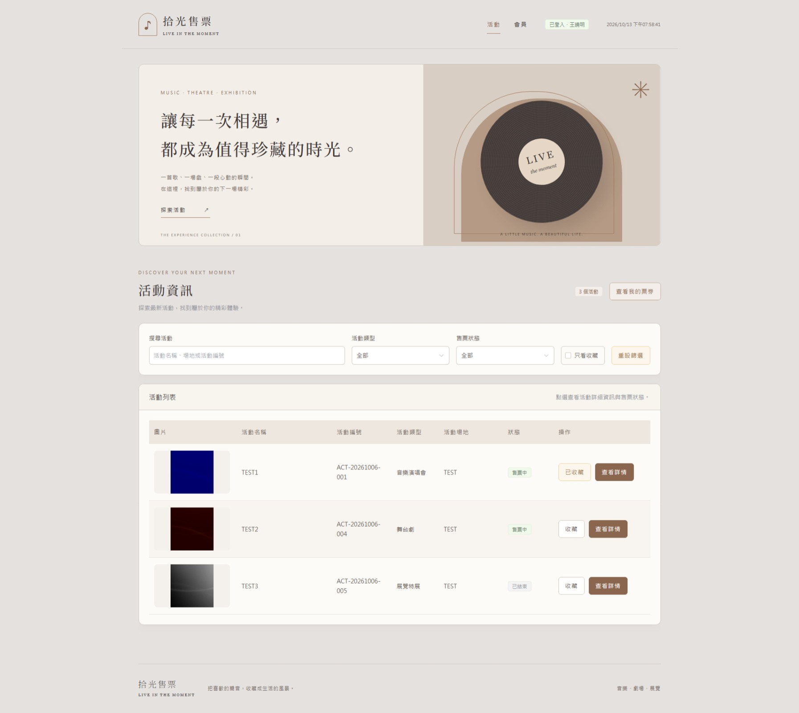

<details>
<summary>展開手機版畫面：活動瀏覽</summary>

<p align="center">
  <a href="docs/images/Activity_phone_1.jpg">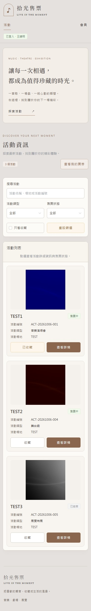</a>
</p>

</details>

### 選位與訂單

選擇日期與場次後，可選票種、篩選分區、查看會員剩餘限購額度及可用座位；選位後顯示實際票價，再確認建立訂單。

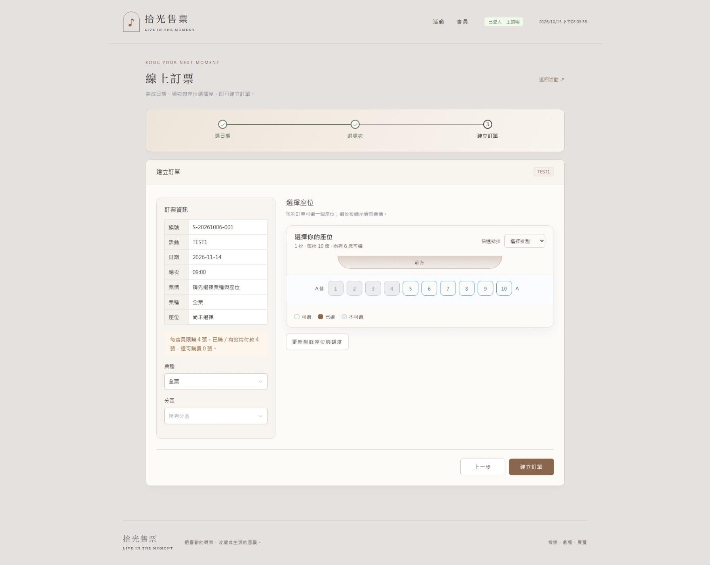

<details>
<summary>展開手機版畫面：選位與建立訂單</summary>

<p align="center">
  <a href="docs/images/booking_phone_1.jpg">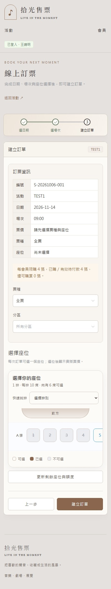</a>
</p>

</details>

「我的票券」列出訂單、場次與座位，顯示已付款、取消及逾期等狀態。

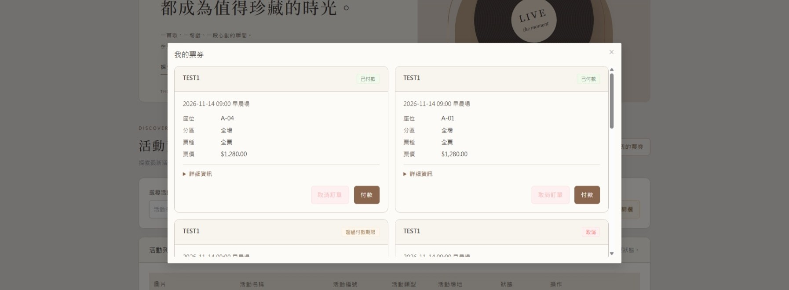

<details>
<summary>展開手機版畫面：我的票券</summary>

<p align="center">
  <a href="docs/images/booking_phone_2.jpg">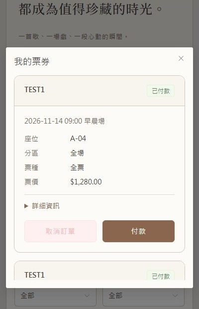</a>
</p>

</details>

### 管理後台

管理員可查看銷售儀表板、維護活動圖片與資料、建立場次，並設定分區票價、票種與會員限購。

#### 銷售儀表板

查看累計營收、整體售票率、可售庫存、訂單狀態及各場次銷售資料。

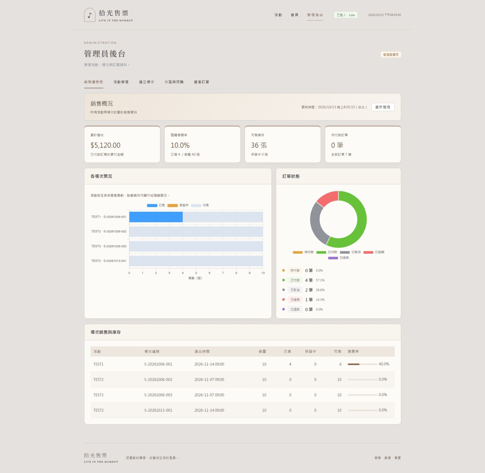

<details>
<summary>展開手機版畫面：銷售儀表板</summary>

<p align="center">
  <a href="docs/images/admin_phone_1.jpg">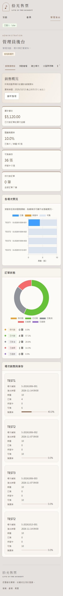</a>
</p>

</details>

#### 活動管理

搜尋與管理活動，查看圖片、類型、場地及票價，並進行新增、修改或刪除。

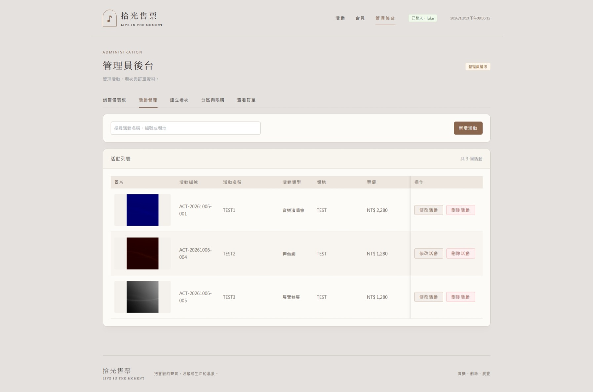

<details>
<summary>展開手機版畫面：活動管理</summary>

<p align="center">
  <a href="docs/images/admin_phone_2.jpg">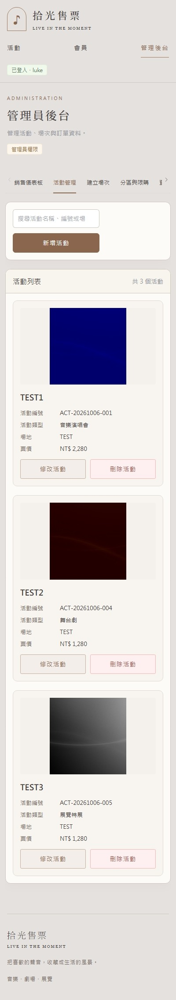</a>
</p>

</details>

#### 建立場次

選擇活動並設定開演、開賣時間與售票狀態，查看已建立場次並進行延期或狀態修改。

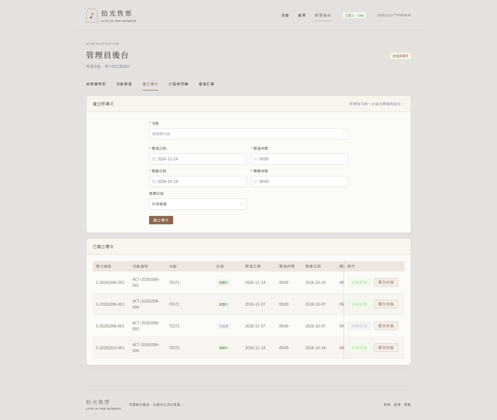

<details>
<summary>展開手機版畫面：建立場次</summary>

<p align="center">
  <a href="docs/images/admin_phone_3.jpg">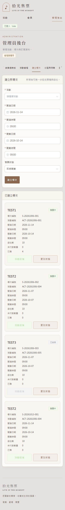</a>
</p>

</details>

#### 分區與限購

設定每會員限購張數、座位分區、票價與票種比例，預覽座位配置並儲存或匯出設定。

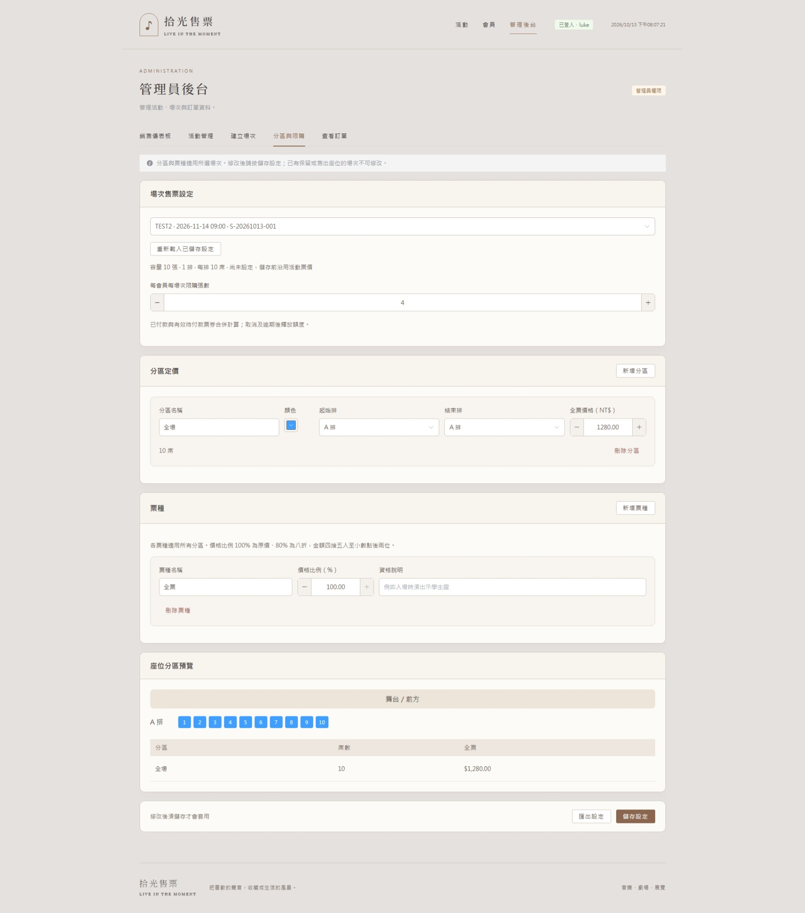

<details>
<summary>展開手機版畫面：分區與限購</summary>

<p align="center">
  <a href="docs/images/admin_phone_4.jpg">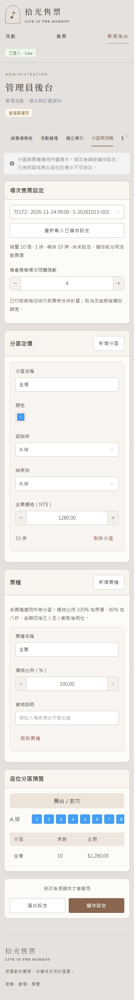</a>
</p>

</details>

#### 查看訂單

查看訂單編號、活動、金額與付款或取消狀態。

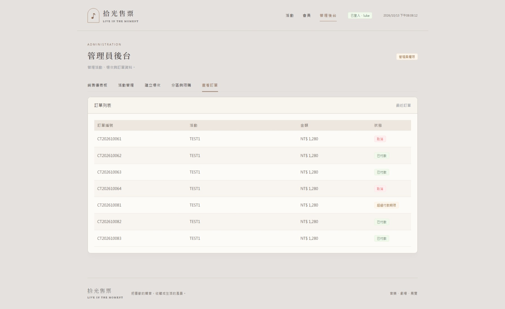

<details>
<summary>展開手機版畫面：查看訂單</summary>

<p align="center">
  <a href="docs/images/admin_phone_5.jpg"></a>
</p>

</details>

### 會員中心

提供會員登入、註冊與修改會員資料。

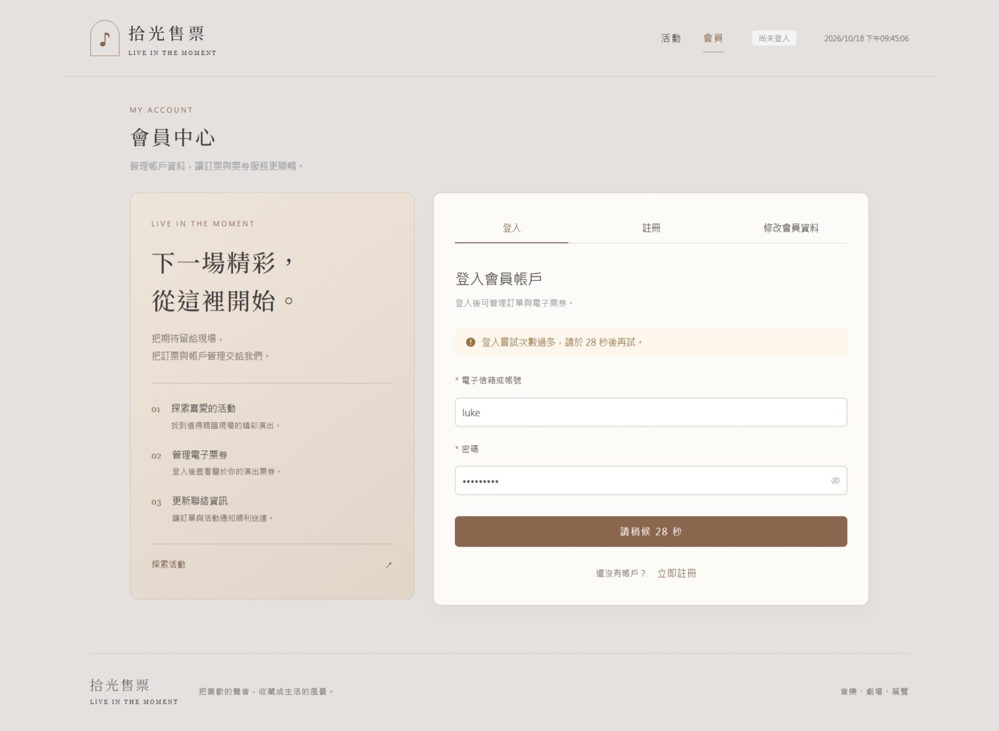

<details>
<summary>展開手機版畫面：會員中心</summary>

<p align="center">
  <a href="docs/images/user_phone.jpg">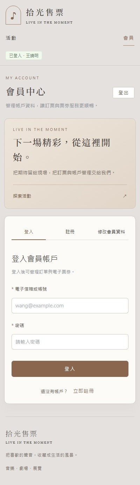</a>
</p>

</details>

## 功能概覽

- 會員：註冊、登入、修改會員資料、登出。
- 活動：查看活動列表、活動圖片與詳情，搜尋篩選、加入／取消收藏及只看收藏。
- 訂票：查詢活動與場次、選擇可用座位、建立訂單、付款、查看票券、取消訂單。
- 管理後台：銷售儀表板、活動／場次／售票資料、活動圖片維護、建立場次，以及分區定價、票種與限購管理。
- 銷售分析：Java 啟動後自動執行 Python，預設每次完成後等待 30 分鐘，產生各場次已付款訂單數與金額的 CSV 報表。

## 功能解析

### 會員與管理員

會員可搜尋和收藏活動、選擇場次與座位、建立訂單、查看票券、付款及取消訂單。座位按場次管理，不同場次互不影響。

管理員可查看銷售儀表板、維護活動與圖片、建立或更新場次，以及設定分區票價、票種和限購張數。已有場次的活動不能刪除。

活動座位從 A 排開始，每排 1～10 席。音樂演唱會最多 50 排、舞台劇 100 排、展覽特展 150 排。手機版會調整表單、列表與座位圖，詳見[前端說明](concert-ticket-frontend/README.md#手機排版與共用列表)。

### 登入與權限

活動可公開瀏覽；訂票需要會員權限，後台操作需要管理員權限。登入後使用 Access Token 呼叫 API，過期時透過 Refresh Token 更新；登出會讓登入憑證失效。

按下登入後，按鈕會顯示處理中，避免連續點擊。短時間內登入太多次時，畫面會提示還要等幾秒，等待期間不能再按登入。預設最多等 60 秒，倒數結束後就能再次登入。安全與部署設定見 [安全設定與部署](docs/SECURITY.md)。

### 訂單與座位

訂單有待付款（`PENDING_PAYMENT`）、已付款（`PAID`）、已取消（`CANCELLED`）、已逾期（`EXPIRED`）四種主要狀態。

建立訂單後保留座位 10 分鐘。付款、取消與逾期時，訂單、座位和庫存一起更新。系統每 30 秒補查逾期訂單，每批最多 100 筆；補查不補送即時通知。

建立訂單必須帶 `Idempotency-Key`，用來辨識重複請求。同會員以相同 key 重送相同訂位，會取得第一次成功的結果；內容不同則回傳 HTTP 409。

### 即時通知與資料

WebSocket 會發送個人訂單通知。付款提醒顯示 30 秒、其他警告 8 秒、一般通知 5 秒，皆可手動關閉；提示的顯示時間不影響付款期限。

PostgreSQL 保存會員、活動、場次與訂單；MyBatis 負責讀寫資料，Redis 管理登入憑證。Docker Compose 啟動前端、後端、資料庫與 Redis，Swagger 提供 API 文件。

### 主要 API 分組

以下路徑皆相對於後端 `/api`；例如活動列表的完整路徑為 `/api/v1/activity/selectAllActivities`。

| 模組 | 代表 API | 用途 |
| --- | --- | --- |
| Activity | `GET /v1/activity/selectAllActivities` | 公開活動列表 |
| Activity.Image | `GET /v1/activity/activityImage/{activityId}` | 公開讀取活動 JPEG；無圖片時回傳 404 |
| Activity.Favorite | `/v1/activity/selectOnlyFavoriteActivities`、`saveFavoriteActivity`、`deleteFavoriteActivity` | 查詢、新增與刪除收藏 |
| Login | `/v1/login/register`、`login`、`validate`、`saveProfile`、`logout` | 帳號與 Token 流程 |
| Booking | 查詢活動／場次／票券、`saveTicket`、`cancelOrder`、`dopayprice` | 會員訂票流程 |
| Booking.Seats | `GET /v1/booking/selectOnlySeats`、`GET /v1/booking/selectOnlyUnavailableSeats` | 場次座位與不可用座位查詢 |
| Admin | 查詢活動／場次／票券、`saveActivity`、`deleteActivity`、`createSession` | 後台管理 |
| Admin.Image | `POST /v1/admin/saveActivity`、`GET /v1/admin/selectAllActivities` | 隨活動儲存可選的 JPEG；管理員活動列表回傳 `image_url`，由圖片 API 載入 |
| Admin.SalesSettings | `GET /v1/admin/sessions/{sessionId}/sales-settings`、`PUT /v1/admin/sessions/{sessionId}/sales-settings` | 查詢與儲存場次分區、票種及限購 |
| Booking.SalesSettings | `GET /v1/booking/sessions/{sessionId}/sales-settings` | 會員查詢票價、分區與剩餘限購額度 |

### 架構流程

```text
Vue 3 / Element Plus
        │ Axios REST + STOMP WebSocket
        ▼
JWT Filter ── Spring Security 角色授權
        │
Spring Boot Controller
        │
Service（交易、狀態判斷、排程、通知）
   ┌────┴────────┐
   ▼             ▼
MyBatis       Redis
   │          Token 狀態
   ▼
PostgreSQL
```

銷售分析由後端的獨立排程執行：

```text
Java SalesAnalyticsScheduler → Python analyze.py → 唯讀查詢 PostgreSQL
                                      │
                                      ▼
                              reports/ 銷售 CSV
```

Python 與 Java 共用資料庫連線設定；Docker 中的 Python 位於後端容器，不另建服務。報表目前以 CSV 提供，尚未顯示於 Vue 後台。

## 技術棧

| 類別 | 技術 |
| --- | --- |
| 前端 | Vue 3、Vite 7、Element Plus 2.14.3、Chart.js 4.5.1、Axios |
| 後端 | Java 21、Spring Boot 4.1.0、Spring Security、MyBatis |
| 銷售分析 | Python、pg8000、python-dotenv |
| 資料儲存 | PostgreSQL 16、Redis 7 |
| 驗證與文件 | JWT、Springdoc OpenAPI / Swagger UI |
| 容器化 | Docker、Docker Compose |
| 測試 | JUnit、Mockito、Playwright（Microsoft Edge）、Python unittest |
| CI | GitHub Actions：後端測試、前端建置、Python 報表測試 |

## 專案結構

```text
concert-ticket-docs/
├── .github/workflows/ci.yml    # GitHub Actions 自動檢查
├── concert-ticket-backend/    # Spring Boot API
├── concert-ticket-frontend/   # Vue 3 網站
├── concert-ticket-analytics/  # Python 銷售分析與 CSV 報表
├── db-init/                   # PostgreSQL 初始化 SQL
├── .env.example               # 前端、後端與分析共用範本
├── FEATURES_ROADMAP.md        # 功能規劃與待完成項目
└── docker-compose.yml
```

## 快速啟動

環境變數範本統一放在根目錄 `.env.example`，各程式仍依自己的位置讀取設定。Docker Compose 使用根目錄 `.env`；本機 Java 預設讀取啟動工作目錄的 `.env`；Vue 使用前端資料夾的 `.env` 或 `.env.local`，僅需其中的 `VITE_*`。本機 Python 環境準備與排程設定見[後端說明](concert-ticket-backend/README.md#python-自動銷售分析)。

先安裝並啟動 Docker Engine／Docker Desktop 與 Docker Compose，以下指令在專案根目錄執行。前端容器使用 Vite 開發伺服器。

1. 複製環境變數範本為 `.env`，並設定安全的密碼。已有 `.env` 時只合併缺少的參數，避免覆蓋原設定。

   ```powershell
   Copy-Item .env.example .env
   ```

   本機 HTTP 開發保留 `REFRESH_COOKIE_SECURE=false`。前端預設連線至 `http://localhost:8080/api` 與 `http://localhost:8080/api/ws`；若需修改，將範本中的 `VITE_*` 寫入 `concert-ticket-frontend/.env.local`。Compose 的前端服務不會讀取根目錄 `.env`。

2. 啟動所有服務。

   ```powershell
   docker compose up --build
   ```

3. 以背景模式執行時，改用：

   ```powershell
   docker compose up --build -d
   ```

首次啟動時，PostgreSQL 會執行 `db-init/` 下的初始化 SQL。若曾以相同資料卷啟動過，初始化 SQL 不會再次自動執行；需要重新初始化資料時，請先確認不再需要現有資料，再執行 `docker compose down -v`。

服務啟動後可使用：

| 服務 | 網址／連線資訊 |
| --- | --- |
| 前端 | http://localhost:5173 |
| 後端 API | http://localhost:8080/api |
| Swagger UI | http://localhost:8080/api/swagger-ui.html |
| OpenAPI JSON | http://localhost:8080/api/v3/api-docs |
| PostgreSQL | `localhost:5432`，資料庫 `interviewworks` |
| Redis | `localhost:6379` |

## 本機開發

需要 JDK 21、Node.js 20.19.0 以上與 npm；啟用 Python 分析時另需 Python 3。以下方式使用 Docker 提供 PostgreSQL 與 Redis，前後端則在本機執行。

1. 依快速啟動準備根目錄 `.env`，從專案根目錄啟動資料庫與快取：

   ```powershell
   docker compose up -d db redis
   ```

2. 在 `concert-ticket-backend/.env` 設定與根目錄相同的 `POSTGRES_PASSWORD`、`REDIS_PASSWORD`，以及 `REFRESH_COOKIE_SECURE=false`。自動分析預設開啟，請依[後端 Python 環境說明](concert-ticket-backend/README.md#python-自動銷售分析)安裝依賴；暫時不使用分析時設定 `ANALYTICS_ENABLED=false`。從專案根目錄切換至後端並啟動：

   ```powershell
   Set-Location concert-ticket-backend
   .\mvnw.cmd spring-boot:run
   ```

3. 後端在本機 8080 埠執行時，前端會自動連線，不用在前端 `.env` 加入連線設定。另開終端機從專案根目錄切換至前端並啟動：

   ```powershell
   # 從專案根目錄的另一個終端機執行
   Set-Location concert-ticket-frontend
   npm ci
   npm run dev
   ```

開啟 http://localhost:5173 即可使用。若後端使用其他網址或埠號，請依[前端連線設定](concert-ticket-frontend/README.md#後端連線設定)修改，並重啟 `npm run dev`。

## 銷售報表與執行紀錄

Docker Compose 將報表掛載至本機 `concert-ticket-analytics/reports/`，可直接開啟 CSV；最新一次 Python 執行輸出位於該目錄的 `analytics-latest.log`。CSV 檔名含 UTC 時間，採 UTF-8 BOM 編碼供 Excel 開啟，每次產生新檔，未設定自動清理。

報表依場次統計目前 `PAID` 訂單數與 `payprice` 加總，無已付款訂單的場次顯示 0。排程開關、間隔與逾時分別由 `ANALYTICS_ENABLED`、`ANALYTICS_DELAY_MS`、`ANALYTICS_TIMEOUT_SECONDS` 控制，預設為 `true`、`1800000` 毫秒與 `120` 秒；修改後需重新啟動後端，Docker 環境可執行 `docker compose up -d app` 套用設定。

## 測試與建置

### 測試工具與功能說明

| 工具 | 專案中的用途 | 設定與程式位置 |
| --- | --- | --- |
| JUnit | 目前只保留載入 Spring 應用程式環境的基本啟動案例，業務功能測試之後再加入。 | 依賴設定：[pom.xml](concert-ticket-backend/pom.xml)；測試：[TicketApplicationTests.java](concert-ticket-backend/src/test/java/com/demo/ticket/TicketApplicationTests.java)。 |
| Mockito | 由 Spring Boot 測試依賴提供；目前未保留使用 mock Mapper 的業務測試案例。 | [pom.xml](concert-ticket-backend/pom.xml) 的 `spring-boot-starter-test`。 |
| Playwright（Microsoft Edge） | 使用 Edge 自動操作網頁，檢查活動載入、搜尋與收藏、未登入導向登入頁、會員登入與票券查詢、管理員後台及訂票流程；包含真實 API 與模擬 API 回應的案例。 | 依賴與指令：[package.json](concert-ticket-frontend/package.json)；瀏覽器設定：[playwright.config.js](concert-ticket-frontend/playwright.config.js)，指定 `channel: 'msedge'`；測試：[tests/e2e](concert-ticket-frontend/tests/e2e)。 |
| Python unittest | 驗證銷售統計只計入已付款訂單、缺少付款金額時報錯、零銷售與免費票處理，以及 CSV 金額精度、Excel 編碼、公式字首防護與避免覆寫既有報表。 | Python 內建測試框架，搭配 `unittest.mock`；測試：[test_analyze.py](concert-ticket-analytics/test_analyze.py)；受測程式：[analyze.py](concert-ticket-analytics/analyze.py)。 |

### 執行方式

後端測試在 `concert-ticket-backend` 執行，需要 Java 21 與後端環境設定：

```powershell
.\mvnw.cmd clean test
```

前端先啟動前後端服務並安裝 Microsoft Edge，再於 `concert-ticket-frontend` 執行（完整操作說明見[前端 README](concert-ticket-frontend/README.md#playwright-網頁自動化測試microsoft-edge)）：

```powershell
npm ci
npm run test:e2e
# 以可見瀏覽器視窗執行
npm run test:e2e:headed
npm run build
```

前端建置產物位於 `dist/`，Playwright HTML 報告位於 `playwright-report/index.html`。測試指令不會自動啟動前後端；首頁案例會呼叫真實活動 API。

Playwright 透過終端機環境變數讀取以下設定，不會自動載入 `.env.local`：

| 環境變數 | 用途 |
| --- | --- |
| `E2E_BASE_URL` | 前端網址，預設 `http://localhost:5173` |
| `E2E_MEMBER_ACCOUNT`、`E2E_MEMBER_PASSWORD` | 真實會員登入與訂票案例；未提供時跳過 |
| `E2E_ADMIN_ACCOUNT`、`E2E_ADMIN_PASSWORD` | 真實管理員登入與查詢案例；未提供時跳過 |
| `E2E_CREATE_ORDER` | 設為 `1` 才會送出真實訂單並查詢確認；預設只走到訂位確認視窗 |
| `E2E_VERIFY_ORDER`、`E2E_VERIFY_SEAT` | 訂票案例改為查詢既有訂單，驗證座位與 `PENDING_PAYMENT` 狀態 |

例如在前端目錄的 PowerShell 設定測試會員後執行：

```powershell
$env:E2E_MEMBER_ACCOUNT = '<測試會員帳號>'
$env:E2E_MEMBER_PASSWORD = '<測試會員密碼>'
npm run test:e2e
```

訂票案例需要售票中的活動、場次與可用座位。啟用 `E2E_CREATE_ORDER=1` 會保留真實待付款訂單並占用座位，測試不會自動取消訂單。

Python 測試需先完成分析虛擬環境安裝，再於 `concert-ticket-analytics` 執行：

```powershell
.\.venv\Scripts\python.exe -m unittest -v test_analyze
```

### 持續整合與驗證範圍

[GitHub Actions 工作流程](.github/workflows/ci.yml) 在推送至 `master` 時執行三項獨立工作：

- 前端：使用 Node.js 22，執行 `npm ci` 與 `npm run build`。
- 後端：使用 Java 21，執行 `bash mvnw --batch-mode clean test`；測試報告以 `backend-test-reports` artifact 保留 7 天。
- Python：使用 Python 3.12，安裝 `requirements.txt` 後執行 `python -m unittest -v test_analyze`。

目前 CI 未執行 Playwright，也未設定 Pull Request 觸發。是否通過應以該次 Actions 執行結果或本機測試報告為準；後端本機報告位於 `concert-ticket-backend/target/surefire-reports/`。

目前後端只保留基本 `TicketApplicationTests.contextLoads()`；前端保留活動、會員、訂票及管理員的原有 Playwright 案例，Python 保留報表測試。訂單、活動圖片、銷售設定、權限與刪除通知的業務測試已移除，預計之後再加入。

`TicketApplicationTests` 載入 Spring 應用程式環境，Python 聚合測試使用 SQLite。上述案例不代表已驗證目前所有功能、真實 PostgreSQL 併發、交易回滾或完整付款流程；新功能驗收依[功能規劃](FEATURES_ROADMAP.md)追蹤。

## 後續規劃

待完成項目包含完整購票與付款 E2E、真實資料庫交易／併發與重啟補償驗證、版本化 migration、將 Playwright 納入 CI、主辦方權限、QR Code 驗票、外部金流與退款，以及負載／壓力測試。詳細規劃見 [FEATURES_ROADMAP.md](FEATURES_ROADMAP.md)；功能實作與驗收完成應分開判讀。

## 常用 Docker 指令

```powershell
# 查看服務狀態
docker compose ps

# 查看並持續追蹤日誌
docker compose logs -f

# 停止服務（保留資料庫資料卷）
docker compose down

# 停止服務並移除資料庫資料卷；此操作會刪除本機資料
docker compose down -v
```

若要同時移除容器、資料卷與映像檔，可使用：

```powershell
docker compose down -v --rmi all
```

## 資料庫與快取檢查

```powershell
# 進入 PostgreSQL（容器名稱預設為 postgres-container）
docker exec -it postgres-container psql -U postgres -d interviewworks
```

進入 PostgreSQL 後可使用：

```sql
SET search_path TO interviewworks_ticket;
\dt
```

```powershell
# 進入 Redis；請依 .env 的 REDIS_PASSWORD 取代 <password>
docker exec -it redis-container redis-cli -a <password>
```

## 延伸文件

- [測試執行方式與 CI 範圍](#測試與建置)
- [功能規劃與待辦](FEATURES_ROADMAP.md)
- [後端說明](concert-ticket-backend/README.md)
- [前端說明](concert-ticket-frontend/README.md)
- [資料庫初始化與訂票一致性](db-init/README.md)
- [Python 銷售分析：Java 啟動後自動產生 CSV 報表](concert-ticket-analytics/README.md)
